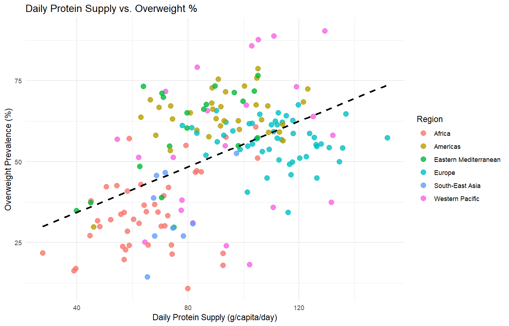
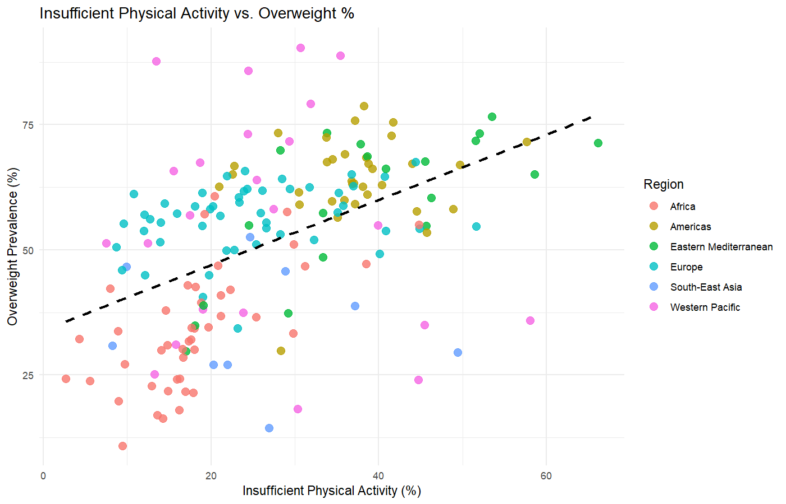
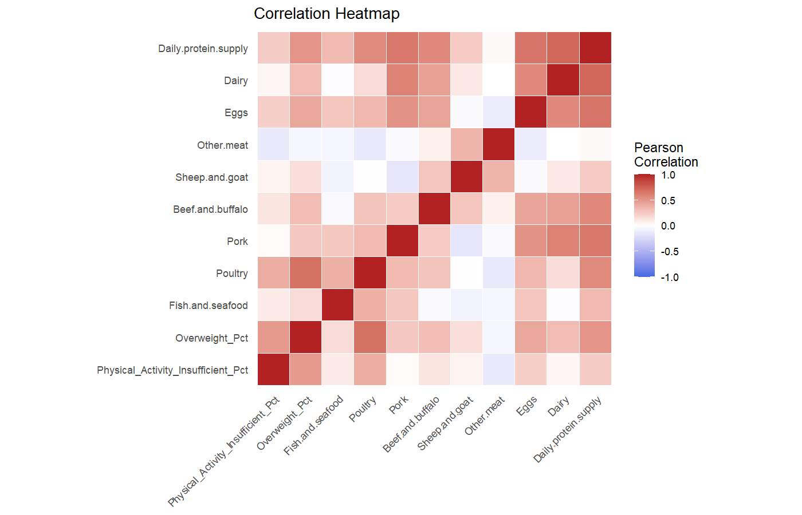
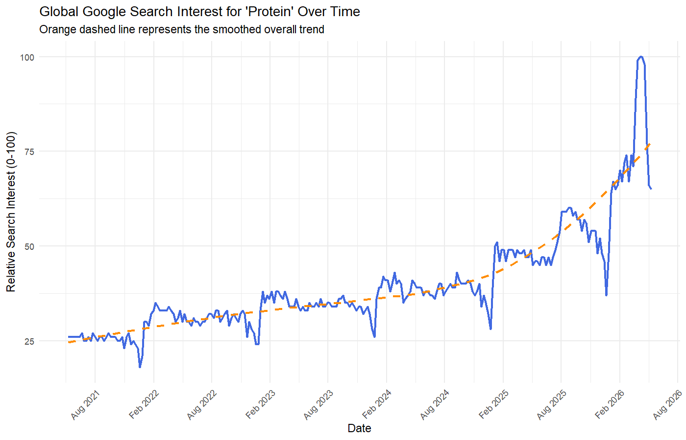

# Protein Paradox: Health, Habits, and Hype

Data analysis project in R exploring whether the world's growing interest in protein
goes together with better health. Data Management course, ACSAI, Year 2.

## Questions

- Does a higher daily protein supply mean a lower obesity rate?
- How much does physical inactivity affect overweight prevalence worldwide?
- Is the world becoming more interested in "protein"? Which countries care most?
- What kinds of animal protein do different regions eat?

## Data

| File | Source |
|---|---|
| `physical activity.csv` | WHO Global Health Observatory: adults with insufficient physical activity |
| `share-of-adults-who-are-overweight.csv` | Our World in Data |
| `daily-per-capita-protein-supply.csv` | Our World in Data |
| `animal-protein-consumption.csv` | Our World in Data |
| `Protein_trend.csv`, `Protein_trend_map.csv` | Google Trends: search interest for "protein" over time and by country |

The most recent year available per country (up to 2023) is used. After cleaning, 180 countries remain.

## Method

1. **`Filtering.R`** keeps the latest year per country, keeps only countries present in every
   dataset, drops missing values, flags outliers with the IQR rule (flagged, not removed, so real
   extremes stay in the data), and merges everything into
   `master_dataset_cleaned_with_regions.csv`.
2. **`Visuals.R`** makes the charts and fits a multiple linear regression:
   `Overweight_Pct ~ Daily.protein.supply + Physical_Activity_Insufficient_Pct`.

## Findings



Countries with a higher daily protein supply per person tend to have a higher share of overweight adults.



Less physical activity also goes with more overweight, though the pattern is more spread out.

**Regression:** together, protein supply and physical activity explain about 40% of the
differences in overweight prevalence between countries (R² = 0.396). Both effects are
statistically significant (p < 0.001):

| Predictor | Effect on overweight % |
|---|---|
| +1 g daily protein supply per person | +0.29 percentage points |
| +1 percentage point insufficiently active adults | +0.52 percentage points |



Almost every protein source is positively linked to overweight prevalence, poultry most strongly.
In countries with a very high protein supply, the surplus comes mostly from dairy and eggs rather
than meat.



Online interest in "protein" keeps rising, yet the countries eating the most protein have the
highest obesity rates. A high protein supply probably reflects eating more calories overall.

**Next step:** check whether the price of protein affects a country's obesity rate.

## How to run

1. Install [R](https://cran.r-project.org/) (and optionally RStudio).
2. Install the packages once:
   ```r
   install.packages(c("ggplot2", "reshape2", "igraph", "ggraph"))
   ```
3. Open this folder as the working directory, then run `Filtering.R` followed by `Visuals.R`.

Full presentation: [Protein_Paradox.pdf](Protein_Paradox.pdf)

---

Author: Rasulov Abdulvoris
